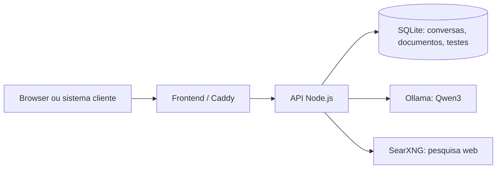

# Local Chat

**Um chat com IA que roda no seu servidor — e mostra quanto ele realmente aguenta.**

[](https://nodejs.org/)
[](https://docs.docker.com/compose/)
[](https://ollama.com/library/qwen3)
[](LICENSE)
[](https://github.com/eupsa/ia/actions/workflows/ci.yml)

Frontend em português com visual preto e branco, API própria, histórico persistente, busca em documentos, ferramentas locais e pesquisa na internet. O usuário baixa pelo painel apenas o modelo que quer usar. Um diagnóstico de carga executado no próprio site mede latência, vazão e concorrência com inferência real.

> **Estado do projeto:** aplicação pessoal ou para um grupo de confiança. A API pode ser publicada com HTTPS e chave Bearer; todos os clientes com a mesma chave compartilham dados. Não há contas individuais nem isolamento por cliente.

**Guias:** [instalação e operação](docs/deployment.md) · [referência da API](docs/api.md) · [metodologia do benchmark](docs/benchmark.md) · [como contribuir](CONTRIBUTING.md) · [segurança](SECURITY.md) · [histórico de versões](CHANGELOG.md).

## O que há aqui

| Área | Recursos |
| --- | --- |
| Chat | Streaming, Markdown, histórico, copiar resposta, interromper geração |
| Modelos | Qwen3 0.6B e 1.7B via Ollama; download e seleção no painel |
| Conhecimento | Arquivos `.txt`/`.md`, busca local SQLite FTS5, trechos consultados na resposta |
| Ferramentas | Calculadora, data/hora, lista e busca de documentos, pesquisa web |
| Internet | SearXNG interno; resultados com links, controle no campo de mensagem |
| Operação | Docker Compose para localhost, VM Oracle ARM64 e API sem frontend |
| Diagnóstico | Teste automático no painel com cenários, percentis, tokens/s, erros e recomendação |



## Comece em localhost

Pré-requisitos: Docker Desktop ou Docker Engine com Compose 2.24.4+, containers Linux e memória disponível para o modelo.

```bash
git clone https://github.com/eupsa/ia.git
cd ia
docker compose up -d --build
```

Abra **[http://localhost:8080](http://localhost:8080)**. Entre em **Meus modelos**, baixe o Qwen3 0.6B (523 MB) ou 1.7B (1,4 GB) e selecione **Usar modelo**. O primeiro carregamento pode demorar. Modelos e conversas ficam em volumes Docker e sobrevivem à recriação dos containers.

O frontend publica somente `127.0.0.1:8080`; a API, o Ollama e o buscador ficam na rede Docker. Nenhum modelo é baixado sem a ação do usuário.

## Diagnóstico de carga automático

Abra **Teste de carga** no menu do site e clique em **Executar diagnóstico automático**. O modelo selecionado precisa estar instalado. O teste continua no backend mesmo se o painel for fechado; os resultados são salvos no SQLite e aparecem em **Resultados salvos** depois de recarregar a página.

Veja a [metodologia completa e como interpretar as métricas](docs/benchmark.md).

| Etapa | Parâmetros programados | Pergunta respondida |
| --- | --- | --- |
| Aquecimento | 1 chamada, fora das métricas | Quanto custa carregar o modelo? |
| Resposta curta | 5 rodadas, 1 chamada por vez, até 128 tokens de saída | Qual é a resposta interativa? |
| Resposta média | 3 rodadas, 1 por vez, até 384 tokens | Quanto custa uma explicação comum? |
| Resposta longa | 2 rodadas, 1 por vez, até 768 tokens | Quanto demora uma resposta extensa? |
| Contexto extenso | 3 rodadas, entrada maior, até 128 tokens de saída | Como o tamanho da entrada afeta a latência? |
| Capacidade | 5 rodadas por nível, com 2, 4 e até 8 chamadas simultâneas | Quantas gerações o serviço consegue atender? |

A concorrência aumenta **até o primeiro nível com mais de 5% de erros ou p95 acima do dobro da linha de base**. O relatório aponta o último nível que passou nesses critérios. Cada resposta usa temperatura `0` e semente `42`; RAG, ferramentas e internet ficam desligados para reduzir variações externas. O teste cria conversas temporárias e as apaga após cada etapa.

O painel mostra TTFT (tempo até o primeiro token), latência total p50/p95, solicitações/s, tokens/s, entrada e saída em tokens, taxa de erro e amostras individuais. A contagem e a duração de geração vêm do Ollama. Erros HTTP 409 aparecem no total de falhas e ficam fora dos percentis das respostas bem-sucedidas. Com 2–5 amostras por cenário, os percentis são **exploratórios**; repita o diagnóstico em horários e condições diferentes para planejamento de capacidade.

Os [relatórios locais de referência](reports/) foram medidos no Docker Desktop em Windows x64 com Qwen3 0.6B. **Não representam a VM Oracle.** Na VM ARM64, execute o diagnóstico no painel depois da instalação para obter os números daquela máquina.

A metodologia usa as definições de [TTFT e throughput da NVIDIA](https://docs.nvidia.com/enterprise-reference-architectures/enterprise-rag-retrieval-scaling-and-sizing-guide/latest/rag-benchmarking-methodology.html), [aquecimento e entradas determinísticas](https://docs.nvidia.com/aicr/latest/user-guide/validation/) e as [métricas de execução do Ollama](https://docs.ollama.com/api/chat).

## Documentos, ferramentas e internet

Use o ícone de clipe para adicionar arquivos `.txt` ou `.md` em UTF-8 (até 200 mil caracteres por arquivo; até 100 arquivos). A API divide o conteúdo em trechos sobrepostos e usa SQLite FTS5/BM25 para recuperar até três trechos relevantes. A busca é lexical: palavras e sinônimos diferentes podem não se encontrar. O controle **Documentos** liga ou desliga a recuperação para a próxima mensagem. PDFs, imagens e OCR ainda não são suportados.

O controle **Ferramentas** libera `calculator`, `current_time`, `list_documents`, `search_documents` e `web_search`. O controle **Internet** permite buscas no SearXNG; perguntas sobre fatos recentes fazem uma busca antes de gerar a resposta. Trechos e links consultados aparecem junto da resposta. Modelos pequenos podem responder incorretamente mesmo com fontes: confira dados importantes.

## Publicar na Oracle ARM64

O Compose padrão limita o Ollama a 3,5 CPUs e 8 GB de RAM, com **um modelo carregado e uma geração por vez**. Foi pensado para uma VM ARM64 com 4 CPUs e 12 GB. O backend retorna HTTP 409 para solicitações de geração simultâneas além da capacidade atual; o diagnóstico mostra essas recusas. A velocidade efetiva precisa ser medida na VM.

**Acesso privado por SSH:** suba o Compose padrão na VM e crie um túnel no computador local:

```bash
ssh -L 8080:127.0.0.1:8080 ubuntu@IP_PUBLICO_DA_VM
```

Abra `http://localhost:8080`. A porta 8080 não precisa ficar pública.

**Site com HTTPS e senha:** aponte um domínio para a VM; libere TCP 80 e 443 na Oracle VCN e no firewall do sistema. Copie `.env.example` para `.env`, configure `DOMAIN`, `AUTH_USER`, `AUTH_PASSWORD_HASH` e `SEARXNG_SECRET`. Gere o hash interativamente e um segredo aleatório para o SearXNG:

```bash
docker run --rm -it caddy:2.10-alpine caddy hash-password
openssl rand -hex 32
docker compose -f compose.yaml -f compose.prod.yaml up -d --build
```

Cole o hash entre aspas simples em `.env` para preservar `$`. O Caddy emite HTTPS e exige autenticação para interface e API. Não publique `.env` no Git.

## API sem frontend

Para integração entre sistemas, use `compose.api.yaml`. Configure em `.env` um `DOMAIN=api.seudominio.com` apontado para a VM, uma `API_KEY` aleatória e um `SEARXNG_SECRET` diferente (gere cada um com `openssl rand -hex 32`). Libere 80/443. Em uma VM já executando o site, faça `docker compose down` primeiro; os volumes permanecem.

```bash
docker compose -f compose.yaml -f compose.api.yaml up -d --build ollama search backend gateway
```

Esse comando **não inicia o frontend**. O Caddy publica apenas rotas `/api/*` via HTTPS. A API exige `Authorization: Bearer SUA_CHAVE`, exceto em `/api/health`. Ollama e SearXNG não publicam portas; a porta 3000 da API é ligada apenas a `127.0.0.1` da VM. Mantenha a chave somente no servidor do cliente, fora de aplicativos distribuídos ao público.

```bash
curl -H "Authorization: Bearer $API_KEY" https://api.seudominio.com/api/models
curl -X POST -H "Authorization: Bearer $API_KEY" -H "Content-Type: application/json" -d '{}' https://api.seudominio.com/api/chats
curl -N -X POST -H "Authorization: Bearer $API_KEY" -H "Content-Type: application/json" -d '{"model":"qwen3:0.6b","content":"Explique uma API em uma frase.","rag":false,"tools":false,"internet":false}' https://api.seudominio.com/api/chats/ID_DA_CONVERSA/messages
```

A resposta da mensagem é NDJSON: linhas com `token` formam o texto; `done:true` traz `eval_count`; `error` sinaliza falha. Guarde o ID para continuar a conversa ou use `DELETE /api/chats/:id` ao terminar. `POST /api/benchmarks` com `{"model":"qwen3:0.6b","mode":"auto"}` inicia o diagnóstico; `GET /api/benchmarks/:id` consulta o resultado. A API usa uma chave compartilhada, sem autorização separada por cliente.

## Estrutura do repositório

```text
backend/             API, SQLite, RAG, ferramentas e benchmark
frontend/            React, Vite e Nginx
compose.yaml         Ambiente local
compose.prod.yaml    Site com Caddy e autenticação
compose.api.yaml     API somente, com Bearer e HTTPS
deploy/              Configuração de Caddy e SearXNG
reports/             Medições locais reproduzíveis
docs/                Guias da API, implantação e diagnóstico
.github/workflows/   CI: testes e build em pushes e pull requests
scripts/             Cliente de benchmark para linha de comando
```

## Desenvolvimento e operação

```bash
npm ci
npm test
npm run build
```

Para desenvolvimento do frontend, mantenha o Compose rodando e execute `npm run dev` na raiz ou em `frontend/`; o Vite abre em `http://localhost:5173` e encaminha `/api` para `127.0.0.1:8080`.

```bash
docker compose ps
docker compose logs --tail=100 backend ollama search
docker compose down
```

`docker compose down` preserva os volumes. **`docker compose down -v` apaga modelos, documentos, conversas e relatórios de teste.** Os dados ficam em `local-chat_data`; os modelos, em `local-chat_models`. Faça backup do volume de dados com o backend parado para incluir os arquivos WAL do SQLite.

Os testes automatizados simulam respostas do Ollama para validar a API; o diagnóstico do painel envia requisições reais. Para executar pela linha de comando, use `node scripts/run-benchmark.mjs` com `API_BASE_URL`, `API_KEY` e `BENCH_MODEL` no ambiente, se necessário.

## Limites conhecidos

- Uma geração por vez; chamadas excedentes podem receber HTTP 409. Não há fila multiusuário.
- Busca em documentos por palavras-chave, sem embeddings nem leitura de PDFs.
- Não há contas individuais, isolamento por cliente ou cobrança.
- A disponibilidade da pesquisa web depende dos mecanismos externos do SearXNG.
- Os resultados locais não devem ser tratados como estimativa de capacidade da VM Oracle.

Para entender os modelos e componentes usados: [Ollama Docker](https://docs.ollama.com/docker), [Qwen3 0.6B](https://ollama.com/library/qwen3:0.6b), [Qwen3 1.7B](https://ollama.com/library/qwen3:1.7b), [SQLite FTS5](https://sqlite.org/fts5.html) e [SearXNG Search API](https://docs.searxng.org/dev/search_api.html).

## Licença

O código deste repositório é distribuído sob a [licença MIT](LICENSE). Os modelos Qwen3, o Ollama, o SearXNG e as imagens Docker são projetos de terceiros com licenças próprias; consulte suas páginas antes de redistribuí-los.
